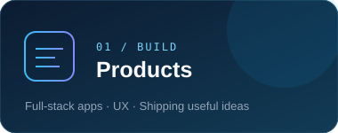
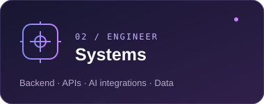
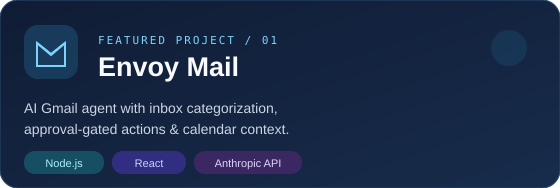

<!--
  Pranesh S | Animated developer profile
  Assets are self-hosted SVGs in ./cards. No external stats widgets required.
-->

  
   
  
  
  

## The short version

I’m **Pranesh**, a BCA graduate and developer who enjoys turning practical ideas into working software. I build across full-stack web development, AI-assisted tools, backend systems, and developer utilities.

I’m especially interested in the engineering behind a product: clear interfaces, reliable APIs, thoughtful data models, and tools that solve real problems.

## Three sides of my work

  
  
  

## Selected work

  
  
  
  

  
<strong>More projects</strong>

  - **[Rift Runner V2](https://github.com/Pranesh0805-S/Game-Development/tree/main/RiftRunnerV2)** — a Python platformer built with Pygame.
  - **[docrot](https://github.com/Pranesh0805-S/docrot)** — a document-oriented developer utility published as an npm package.
  - **[DevMate V3](https://huggingface.co/Pranesh0805-S/DevMate-V3)** — a coding assistant fine-tuned from Qwen3-0.6B with LoRA and evaluated across programming topics.

## Tools I work with

| Area | Technologies |
|---|---|
| Languages | Python, JavaScript, Java, C, C++, SQL |
| Frontend | React, HTML, CSS, Vite |
| Backend | Node.js, Express, FastAPI, REST APIs |
| Data | MySQL, MongoDB, PostgreSQL, Supabase, pgvector |
| AI engineering | LLM APIs, prompt integration, LoRA fine-tuning |
| Tools & platforms | Git, GitHub, Vercel, Render, Figma |

## GitHub activity

  
   
  

## A little more

- 🎓 **BCA** — Bishop Appasamy College of Arts and Science, Coimbatore (2023–2026)
- 🧩 Practising data structures and algorithms alongside product development.
- 🛠️ Interested in AI-enabled applications, developer experience, and backend architecture.
- 🤝 Organized a debugging competition at **Bliss 2025** and attended **Google Cloud Community Day 2025**.
- 📚 MongoDB — Introduction to MongoDB for Students.

## Find me

  <a href="https://github.com/Pranesh0805-S">GitHub</a> ·
  <a href="https://www.linkedin.com/in/pranesh0805/">LinkedIn</a> ·
  <a href="mailto:pranesh8506s@gmail.com">Email</a>
    
  Build with intent. Learn in public. Improve every release.

