  

  
  
  

  

  
  
  
  

  

  
  
  
  

<b>More projects &amp; tools</b>

- **[Rift Runner V2](https://github.com/Pranesh0805-S/Game-Development/tree/main/RiftRunnerV2)** — a Python platformer built with Pygame.
- **[docrot](https://github.com/Pranesh0805-S/docrot)** — an npm package that checks code examples in package docs against the package's actual exports.
- **[DevMate V3](https://huggingface.co/Pranesh0805-S/DevMate-V3)** — a coding assistant fine-tuned from Qwen3-0.6B with LoRA.

| Area | Technologies |
| --- | --- |
| Languages | Python, JavaScript, Java, C, C++, SQL |
| Frontend | React, HTML, CSS, Vite |
| Backend | Node.js, Express, FastAPI, REST APIs |
| Data | MySQL, MongoDB, PostgreSQL, Supabase, pgvector |
| AI engineering | LLM APIs, prompt integration, LoRA fine-tuning |
| Tools | Git, GitHub, Vercel, Render, Figma |

Build with intent. Learn in public. Improve every release.

